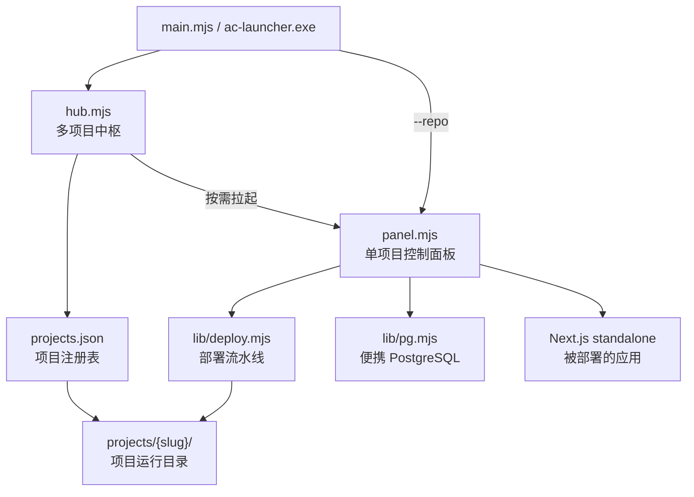

# ac-launcher

[](https://github.com/Rylin512/ac-launcher/releases)


**AgileCampus 独立部署控制台**：把本地源代码仓库的部署、数据库与运行状态集中到一个面板里。

ac-launcher 在源代码仓库之外运行，对仓库保持只读。它把「同步源码 → 安装依赖 → 初始化 PostgreSQL → 推送表结构 → 构建 Next.js → 启动应用」整条链路变成可点击、可观测的任务，并用一个中枢进程集中管理和监视多个项目。

## 目录

- [项目简介](#项目简介)
- [功能特性](#功能特性)
- [系统架构](#系统架构)
- [快速开始](#快速开始)
- [命令行用法](#命令行用法)
- [部署流水线](#部署流水线)
- [运行目录与数据布局](#运行目录与数据布局)
- [端口分配](#端口分配)
- [项目结构](#项目结构)
- [构建便携版](#构建便携版)
- [自检与验证](#自检与验证)
- [常见问题](#常见问题)
- [安全说明](#安全说明)
- [贡献](#贡献)
- [许可证](#许可证)

## 项目简介

AgileCampus 是一个基于 Next.js、Drizzle ORM 与 PostgreSQL 的应用。ac-launcher 不参与业务逻辑，只负责把它在本机跑起来：

- **中枢**：登记多个源代码仓库，持续监视每个项目的应用、数据库与面板状态，按需拉起子面板；
- **控制面板**：完成首次部署、同步源码、重新构建、启停应用、管理数据库、查看日志与配置；
- **隔离运行**：源码只读，所有构建产物、数据库文件、日志与密钥都写在独立的运行目录中。

适用于 Windows 本机开发、演示与独立部署，不需要管理员权限，也不需要预先安装 PostgreSQL。

## 功能特性

| 能力 | 说明 |
|---|---|
| 多项目管理 | 一个中枢进程监视所有已登记项目，子面板按需启动，不常驻 |
| 七步部署 | 同步源码、安装依赖、初始化数据库、推送表结构、构建前端、装配产物、启动应用 |
| 数据库运维 | 自动下载并运行便携版 PostgreSQL 16/17；支持表结构修复、环境检修与重置数据库 |
| 源码只读 | 对原仓库全程只读；构建与运行数据写入独立运行目录 |
| 端口预约 | 每个项目的面板、应用、数据库端口在加入时预约并持久化，可一键重新分配 |
| 零运行时依赖 | 面板只使用 Node 内置模块，可在 `npm ci` 之前启动并完成首次部署引导 |
| 单文件分发 | 支持打包成单个 `ac-launcher.exe`（Node SEA + postject），目标机器无需安装 Node 即可启动控制台 |
| 可观测性 | 任务进度实时推送，构建、应用、数据库、面板日志分文件保存 |
| 环境自检 | 内置多组验证脚本，覆盖端口一致性、部署环境、退出流程、旧部署清理等不变式 |

## 系统架构



设计原则：

- **控制面与被控服务分离**：停止面板不等于停止应用与数据库；中枢只做列表、监视、打开与停止。
- **一个项目一个运行目录**：避免不同项目的 `node_modules`、数据库与端口互相覆盖。
- **端口按预约分配**：不依赖「此刻是否在监听」，避免两个停止中的项目被分配到同一端口。
- **控制面不出本机**：中枢与面板只监听 `127.0.0.1`；只有被部署的应用对局域网开放。
- **源码零写入**：同步源码是复制而非原地构建，运行目录可整体备份、迁移或清理。

## 快速开始

### 环境要求

| 项目 | 要求 |
|---|---|
| 操作系统 | Windows 10 1803 及以上（推荐）；类 Unix 系统可运行源码，便携打包以 Windows 为主 |
| Node.js | 20 及以上，用于源码运行、部署目标项目与打包 |
| 目标仓库 | Next.js 应用（`output: "standalone"`）、Drizzle ORM、提供 `npm run build` 与 `npm run db:push` 脚本 |
| 权限 | 普通用户即可，不需要管理员权限 |

> 便携版 exe 内嵌自身运行所需的 Node 运行时，但目标项目的 `npm ci` / `next build` 仍需一个可用的 Node 20+。源码模式下的 `start.cmd` 会在缺失时自动下载便携 Node v22 到运行目录；便携版可用 `--node` 指定，或将 Node 加入 `PATH`。

### 方式一：便携版

1. 从 [Releases](https://github.com/Rylin512/ac-launcher/releases) 下载 `ac-launcher.exe`；
2. 双击运行，打开中枢；
3. 点击「添加项目」选择 AgileCampus 仓库目录，再点击「打开控制面板」。

也可以把仓库文件夹直接拖到 exe 上，或在命令行中指定仓库，直接打开该项目的面板：

```bat
ac-launcher.exe D:\src\agilecampus
ac-launcher.exe --repo D:\src\agilecampus
```

### 方式二：源码运行

Windows：

```bat
start.cmd
```

`start.cmd` 会依次检查运行目录与 `PATH` 中的 Node，缺失或版本低于 20 时自动下载便携版，然后启动中枢。

任意平台也可直接使用 Node：

```bash
node main.mjs                                  # 打开中枢
node main.mjs --repo /path/to/agilecampus      # 打开指定项目的面板
```

### 首次部署

1. 在中枢中添加项目，确认端口分配；
2. 打开控制面板，点击「首次部署」；
3. 等待七步流水线完成，面板会自动启动应用；
4. 通过「打开网站」访问应用；需要局域网访问时使用面板显示的局域网地址。

首次部署不会修改原仓库中的任何文件。构建产物、数据库与日志都位于运行目录。

## 命令行用法

```text
ac-launcher.exe                     打开中枢，管理并监视多个项目
ac-launcher.exe <仓库目录>          为该仓库打开控制面板
ac-launcher.exe --repo <路径>       同上，显式指定仓库
```

| 选项 | 说明 |
|---|---|
| `--repo <路径>` | 项目仓库目录（只读，绝不写入） |
| `--runtime-dir <路径>` | 运行目录，默认为 `%LOCALAPPDATA%\AgileCampus`（非 Windows 为 `~/.agilecampus`） |
| `--node <路径>` | 指定用于 `npm` / 构建 / 启动应用的 Node 可执行文件 |
| `--port <n>` | 中枢端口，默认 8788，被占用时自动顺延 |
| `--no-open` | 不自动打开浏览器 |
| `--selftest` | 打印解析后的配置与自检信息后退出 |
| `--help` / `--version` | 显示帮助 / 版本 |

运行目录的解析优先级：`--runtime-dir` > 环境变量 `AC_RUNTIME_DIR` > 默认目录。仓库目录的解析优先级：`--repo` > 环境变量 `AC_REPO_DIR` > 运行目录中记录的上次仓库 > 当前工作目录。

## 部署流水线

| 步骤 | 内容 |
|---|---|
| 1. 同步源码 | 将仓库复制到运行目录 `src/`，排除 `node_modules`、`.next`、`.git`、`deploy` 等 |
| 2. 安装依赖 | 执行 `npm ci`；lockfile 未变化时跳过 |
| 3. 初始化数据库 | 下载并解压便携版 PostgreSQL（优先 16.x，其次 17.x），`initdb` 并创建数据库 |
| 4. 推送表结构 | 执行 `npm run db:push`；检测到可能丢数据的变更时先停止并输出变更计划 |
| 5. 构建前端 | 执行 `npm run build`，要求 Next.js `output: "standalone"` |
| 6. 装配产物 | 把 `public/` 与 `.next/static` 复制进 standalone 产物 |
| 7. 启动应用 | 以 detached 进程运行 standalone `server.js`，注入运行目录中的 `.env` |

面板提供「首次部署」「重新部署」「仅同步源码」「修复表结构（保留数据）」「检修数据库」「重置数据库」等操作。破坏性操作需要二次确认，数据库重置还要求输入确认短语。

## 运行目录与数据布局

默认运行目录：

- Windows：`%LOCALAPPDATA%\AgileCampus`
- 其他平台：`~/.agilecampus`

```text
<运行目录>/
├── projects.json              # 项目注册表
├── config/
│   └── hub.secret             # 中枢监督令牌
├── run/
│   └── hub.lock               # 中枢进程锁
├── logs/
│   └── hub.log                # 中枢日志
├── engine/
│   └── <hash>/                # 便携版 exe 释放的引擎源码副本
└── projects/
    └── <slug>/                # 单个项目的运行目录
        ├── config/panel.json  # 端口、数据库连接串、密码等
        ├── src/               # 源代码副本（含构建产物与 .env）
        ├── node/              # 便携版 Node（如已下载）
        ├── pgsql/             # 便携版 PostgreSQL
        ├── pgdata/            # 数据库数据目录
        ├── run/               # 应用、数据库与面板的锁文件
        ├── logs/              # 构建、应用、数据库、面板日志
        └── tmp/               # 下载与解压的临时目录
```

旧版本在数据根直接创建的单项目部署会在启动时被原地收编进注册表，不会被搬动或删除。注册表里指向同一个运行目录或同一个仓库的重复条目会在启动时自动合并，已堆出来的重复也会在下次启动时清理掉。

## 端口分配

| 角色 | 默认值与范围 | 监听地址 |
|---|---|---|
| 中枢 | 8788，被占用时在 8788–8799 内顺延 | `127.0.0.1` |
| 面板 | 从 8800 起预约 | `127.0.0.1` |
| 应用 | 3000 → 3080 → 3100–3199 | `0.0.0.0`（局域网可访问） |
| PostgreSQL | 从 55432 起预约 | `127.0.0.1` |

端口在项目加入时一次性预约并写入该项目的 `config/panel.json`。需要修改时请在中枢中点击「重新分配端口」，它会同步更新数据库连接串与 `.env` 中的派生配置。

## 项目结构

```text
ac-launcher/
├── main.mjs                  分发入口：中枢或面板
├── hub.mjs                   多项目中枢
├── panel.mjs                 单项目控制面板
├── boot.cjs                  单文件 exe 的 SEA 引导
├── start.cmd                 Windows 源码模式启动脚本
├── lib/
│   ├── config.mjs            路径、配置、密钥、.env
│   ├── registry.mjs          项目注册表与子面板管理
│   ├── deploy.mjs            部署流水线
│   ├── pg.mjs                便携 PostgreSQL 的下载、初始化与启停
│   ├── dbdoctor.mjs          数据库环境检修与修复
│   ├── process.mjs           应用进程管理
│   ├── ports.mjs             端口候选与预约
│   ├── jobs.mjs              长任务与日志推送
│   ├── nodebin.mjs           Node 查找与 SEA 模式适配
│   ├── preflight.mjs         部署前环境检查
│   ├── sysinfo.mjs           系统与网络信息
│   └── http.mjs              HTTP 工具与访问护栏
├── ui/index.html             控制面板界面
├── hub-ui/index.html         中枢界面
├── build/build-sea.mjs       便携版构建脚本
├── verify-*.mjs              自检与回归脚本
├── package.json
└── LICENSE
```

## 构建便携版

```bash
npm ci
npm run build
```

产物为 `dist/ac-launcher.exe`。构建流程包含四步：界面与不变式门禁、生成 SEA blob、复制 Node 宿主、使用 `postject` 注入 blob。

说明：

- `postject` 仅在打包时使用，面板运行本身没有第三方依赖；
- 注入后原 `node.exe` 的 Authenticode 签名会失效，跨机器分发时可能触发 SmartScreen 或杀毒软件提示；
- 构建脚本会在打包前运行 `verify-ui`、`verify-hub-render`、`verify-ports`、`verify-childenv`、`verify-panelstate`、`verify-preflight`、`verify-legacypurge`、`verify-engine`、`verify-shutdown` 等门禁。

## 自检与验证

```bash
npm run selftest          # 打印启动配置与自检信息
npm run verify:repo       # 证明原仓库未被改动
npm run verify:ui         # 检查界面反馈链路
```

独立的验证脚本也可直接运行：

| 脚本 | 验证内容 |
|---|---|
| `verify-ports.mjs` | 端口与 `databaseUrl`、`.env` 派生配置的一致性 |
| `verify-preflight.mjs` | 部署用子进程环境与 PATH 可用性 |
| `verify-childenv.mjs` | 子进程能找到 Node |
| `verify-panelstate.mjs` | 「面板在不在」与「面板答不答话」两个判断不混淆 |
| `verify-engine.mjs` | 引擎目录清理不会删除正在使用的副本 |
| `verify-legacypurge.mjs` | 旧部署清盘不会误删中枢自身的数据 |
| `verify-shutdown.mjs` | 退出面板流程与护栏拒绝留痕 |
| `verify-realloc.mjs` | 重新分配端口的端到端流程 |
| `verify-hub-render.mjs` | 中枢页面用真实状态渲染不崩溃 |
| `verify-repo.mjs` | 采集并比对仓库文件哈希，证明源码只读 |
| `verify-ui.mjs` | 检查面板界面的反馈与跳转链路 |

部分脚本（如 `verify-shutdown.mjs`、`verify-preflight.mjs`）依赖 Windows 环境；构建门禁会运行其中与平台无关的部分。

## 常见问题

**启动时端口被占用怎么办？**

中枢会在 8788–8799 内自动顺延；项目端口由中枢统一预约。需要固定中枢端口时使用 `--port <n>`，项目端口请在中枢里「重新分配端口」。

**列表里有重复的「收编的旧部署」怎么办？**

升级后重启一次中枢即可：启动时会按规范化的运行目录与仓库路径合并重复条目并写回 `projects.json`，磁盘上的部署文件不会被删。详见[常见问题文档](docs/faq.md#列表里出现多条收编的旧部署怎么办)。

**面板会修改我的源码仓库吗？**

不会。ac-launcher 对源仓库只读，构建、数据库与日志全部写入运行目录。可用 `npm run verify:repo` 采集并比对文件哈希。

**更新源码后数据库报「列不存在 / 表不存在」，又不想丢数据怎么办？**

在面板中点击「修复表结构（保留数据）」。它只把 `src/db/schema.ts` 推到数据库，不做构建、也不清空数据；检测到 `DROP TABLE` / `TRUNCATE` 等丢数据变更时会先停下并输出变更计划。

**换一台电脑部署时 `initdb` 失败、数据库起不来怎么办？**

先点击面板中的「检修数据库」，它会逐项检查运行库、权限、路径、磁盘空间等常见原因并给出可执行的修复项。完整排查步骤见 [常见问题文档](docs/faq.md#换一台电脑部署时报-initdb-失败)。

**目标电脑不能联网，或下载 PostgreSQL 总是失败怎么办？**

可在任意联网机器上下载 PostgreSQL 免安装 zip，按约定文件名放进项目运行目录的 `tmp/`，面板会优先使用它。详见[常见问题文档](docs/faq.md#目标电脑不能联网或下载-postgresql-失败)。

更多数据库与迁移问题见 [docs/faq.md](docs/faq.md)。

## 安全说明

- 中枢与面板只监听 `127.0.0.1`，控制平面不出本机；被部署的应用监听 `0.0.0.0`，默认对局域网开放。
- 中枢监督令牌保存在 `<运行目录>/config/hub.secret`；项目数据库密码与连接串保存在 `<运行目录>/projects/<slug>/config/panel.json`，`.env` 中可能包含飞书等第三方凭据。
- 这些文件按「本机文件系统信任级别」保护，界面上只做打码显示。请勿把运行目录共享、提交到 Git 或放入同步盘。
- 不要将面板或中枢端口通过反向代理、内网穿透暴露到公网。
- 便携版 exe 未做代码签名，首次运行可能触发 SmartScreen 或杀毒软件告警；请只从本仓库 Releases 下载。

## 贡献

欢迎通过 [Issues](https://github.com/Rylin512/ac-launcher/issues) 反馈问题。提交改动前建议运行：

```bash
npm run selftest
npm run verify:repo
npm run verify:ui
```

涉及端口、部署、退出流程或数据库检修的改动，请同时运行对应的 `verify-*.mjs` 脚本，并在 PR 中说明验证结果。

## 许可证

本项目使用 [MIT License](LICENSE)。
